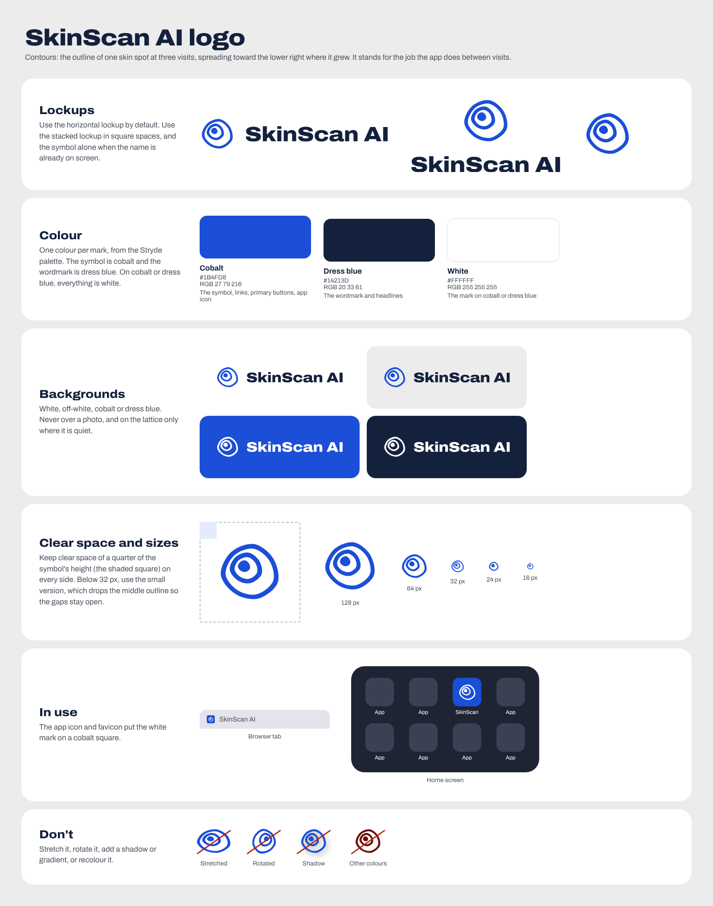

# SkinScan AI logo

The symbol is called **Contours**. It shows the outline of one skin spot at three visits, spreading toward the
lower right where the spot grew. Following a lesion between visits is what the app does, and the outlines are
drawn the way a clinician traces a lesion's edge.

## Files (`kit/`)

| File | Use |
| --- | --- |
| `skinscan-horizontal-color.svg` | Default lockup: cobalt symbol, dress-blue wordmark |
| `skinscan-horizontal-white.svg`, `-navy.svg`, `-black.svg` | On cobalt or dress blue; one-colour print |
| `skinscan-stacked-color.svg`, `-white.svg` | Square spaces |
| `skinscan-symbol-cobalt.svg`, `-navy.svg`, `-black.svg`, `-white.svg` | Symbol alone, 32 px and up |
| `skinscan-symbol-small-cobalt.svg`, `-white.svg` | Symbol alone, 16 to 31 px |
| `skinscan-wordmark-navy.svg`, `-white.svg` | Name alone |
| `skinscan-app-icon.svg`, `icon-48/180/192/512.png` | App icon (rounded cobalt square) |
| `skinscan-maskable.svg`, `icon-maskable-512.png` | Android maskable icon |
| `skinscan-favicon.svg`, `favicon.ico` (16, 32, 48) | Browser tab |
| `skinscan-horizontal-color-1200.png` | Documents and slides |

`python3 brand/logo/kit.py` rebuilds every file from the geometry in `kit.py` and copies the web icons into
`docs/icons/` and `docs/favicon.ico`.

## Construction

- 256 by 256 grid. Three nested copies of one smooth, slightly asymmetric spot shape (seven points, radii
  between 0.92 and 1.04 of the mean, turned 8 degrees).
- Outer outline radius 100, middle outline 52, spot 23. Outlines are filled bands 18 units wide, close to the
  wordmark's stem weight. They are fills, not strokes, so they scale exactly.
- Each shape sits 9 units inside the next on the upper left and about 50 units away on the lower right.
- White on dark uses 17-unit bands, because light marks on dark grounds look heavier.
- Small version: the middle outline is dropped, the outer band is 26 units and the spot is radius 40, so the
  gaps stay open at 16 px.

## Wordmark

"SkinScan AI" in Archivo (SIL Open Font License, which allows logo use), width 115, weight 850,
tracking -0.01 em, converted to outlines. It matches the Stryde headlines. In the horizontal lockup the cap height is 0.40 of the symbol's
height and the gap is 0.27 of it.

## Colour

From the Stryde palette.

| Name | HEX | RGB | Use |
| --- | --- | --- | --- |
| Cobalt | `#1B4FD8` | 27 79 216 | Symbol, app icon |
| Dress blue | `#14213D` | 20 33 61 | Wordmark |
| White | `#FFFFFF` | 255 255 255 | Everything, on cobalt or dress blue |

No Pantone match has been checked against a physical swatch; do that before printing in spot colour.

## Rules

- Clear space: a quarter of the symbol's height on every side.
- Minimum sizes: symbol 16 px (small version below 32 px); horizontal lockup 24 px tall.
- Backgrounds: white, off-white `#ECECEC` (the lattice is fine where it is quiet), cobalt or dress blue. Not over photos.
- Don't stretch, rotate, recolour, outline, or add shadows, gradients or effects.

## Open items

- Trademark clearance has not been checked. Search the USPTO and other trademark databases, and run a reverse
  image search, before registering or printing.
